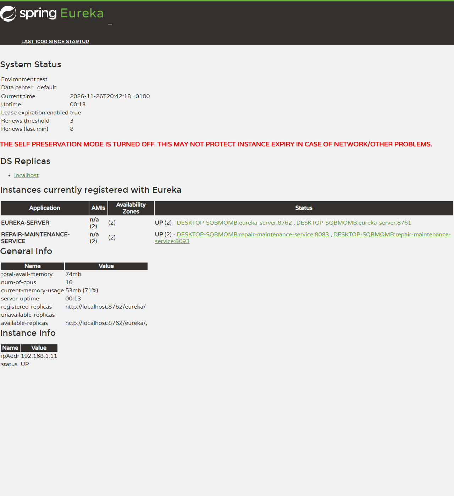
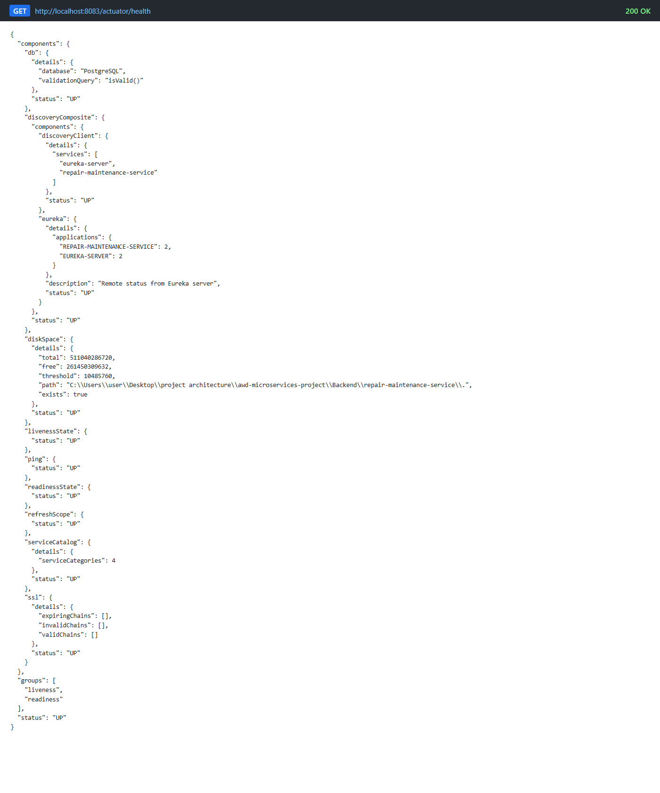
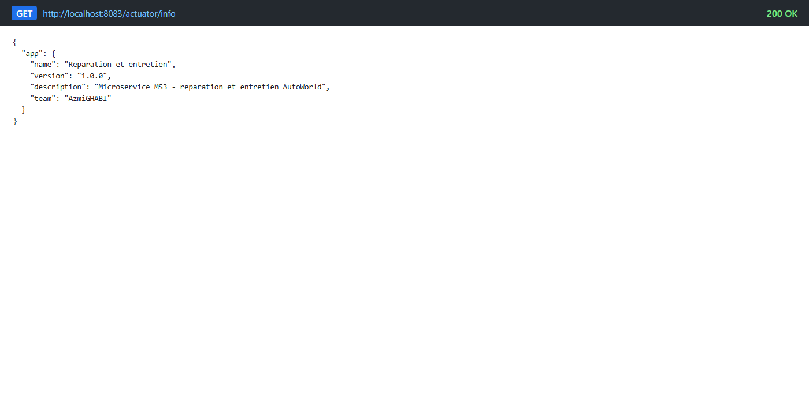
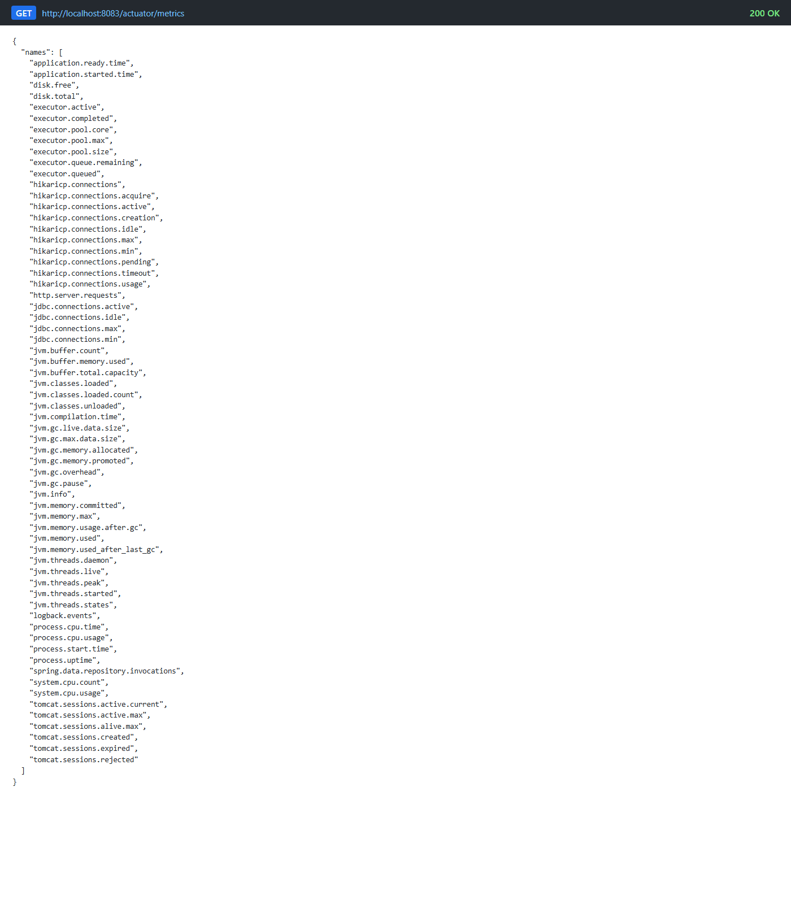
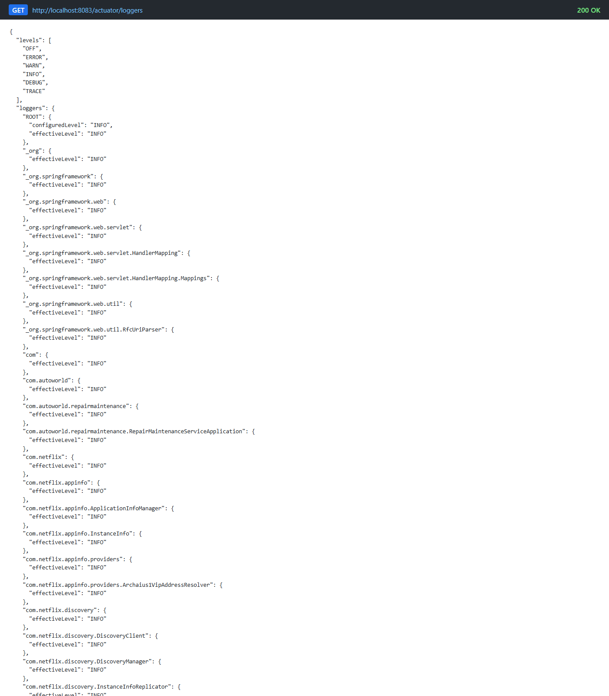
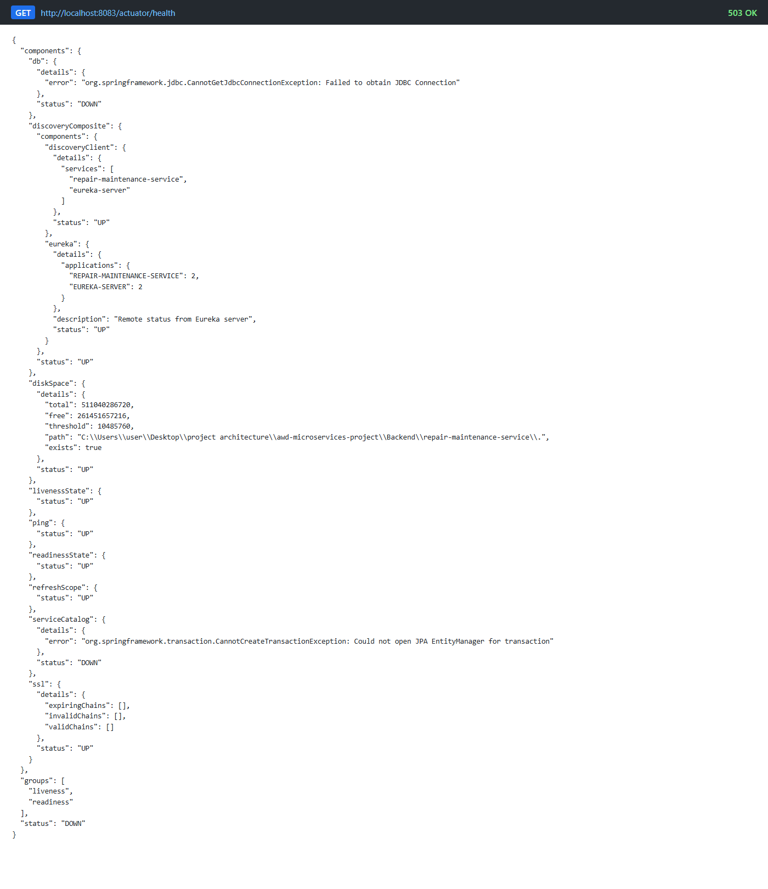
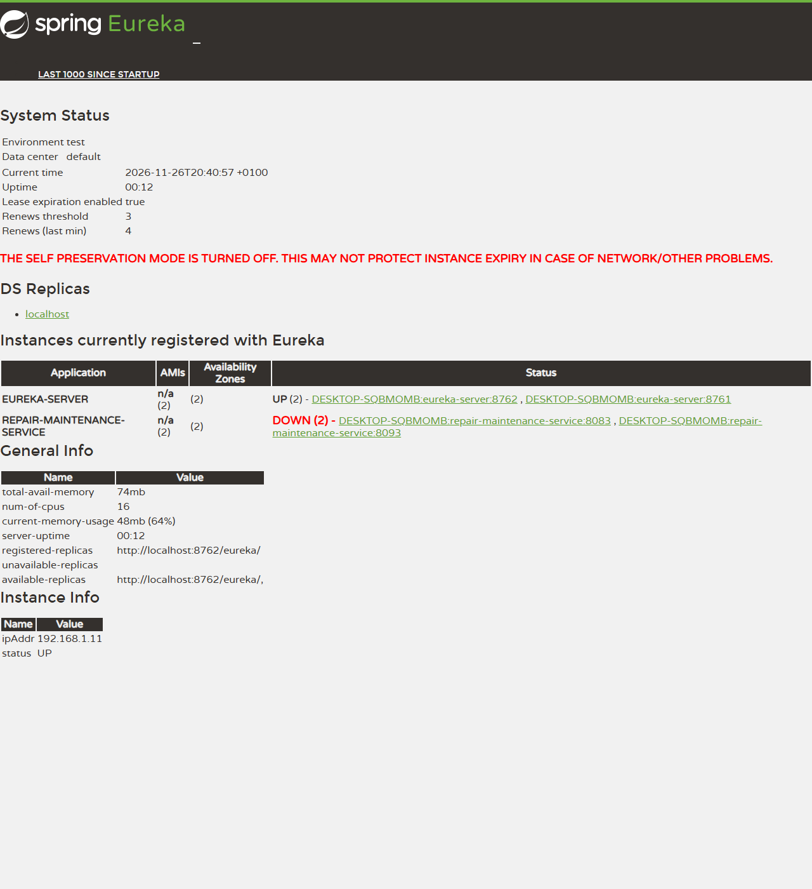

# AutoWorld — Microservices

Projet **Architecture Web Distribuée** — plateforme AutoWorld.

- **Branche** : `Réparation_entretien`
- **Microservice** : MS3 — Réparation & entretien (`repair-maintenance-service`, port `8083`)
- **Équipe (branche MS3)** : AzmiGHABI

> **Note (fusion dans `master`)** : ce README était à la racine de la branche `Réparation_entretien`. Sur `master`, le serveur Eureka conservé est celui partagé par l'équipe (`Backend/eureka-server`, Spring Boot 3.5 — voir [son README](../eureka-server/README.md)) ; la description du module Eureka ci-dessous correspond à la version de la branche MS3. MS3 s'y enregistre sans changement (mêmes ports `8761` / `8762`).

Ce README documente les deux ateliers réalisés sur MS3 :

1. **Atelier 1 — Implémentation « Eureka server »** : serveur de découverte + enregistrement du microservice + plusieurs instances.
2. **Atelier 2 — Observabilité avec Spring Boot Actuator** : health, info, metrics, loggers, indicateur de santé personnalisé et propagation de l'état dans Eureka.

## Architecture

| Composant | Technologie | Port | Nom dans Eureka | État sur cette branche |
|---|---|---|---|---|
| Eureka Server | Spring Boot | 8761 et 8762 | — | Réalisé (2 pairs en haute disponibilité) |
| MS3 — Réparation & entretien | Spring Boot + PostgreSQL | 8083 (2ᵉ instance : 8093) | `REPAIR-MAINTENANCE-SERVICE` | Réalisé |
| Vehicle Sales | Spring Boot | 8081 | `VEHICLE-SALES-SERVICE` | Squelette (branche dédiée) |
| Vehicle Rental | Spring Boot | 8082 | `VEHICLE-RENTAL-SERVICE` | Squelette (branche dédiée) |
| Spare Parts | Spring Boot | 8084 | `SPARE-PARTS-SERVICE` | Squelette (branche dédiée) |
| Profiles & Professionals | Spring Boot | 8085 | `PROFILES-PROFESSIONALS-SERVICE` | Squelette (branche dédiée) |

> Les autres microservices seront enregistrés dans le même serveur Eureka depuis leurs branches respectives. Le dashboard final de l'équipe les affichera tous.

## Versions

- **Spring Boot 4.2.0** et **Spring Cloud 2026.0.0** (paire supportée : le BOM Spring Cloud 2026.0.0 cible Spring Boot 4.2.x).
- Java **17** (Temurin), Maven 3.9+.
- L'atelier propose l'exemple Spring Boot 3.5.x / Spring Cloud 2025.0.x ; le projet utilise la version courante alignée avec la démonstration du professeur (Spring Boot 4.2).

---

# Atelier 1 — Eureka Server

## Ce qui a été fait

- Création du module `Backend/eureka-server` :
  - dépendance `spring-cloud-starter-netflix-eureka-server` ;
  - annotation `@EnableEurekaServer` ;
  - mode isolé par défaut (`application.properties`, port `8761`, `register-with-eureka=false`, `fetch-registry=false`) ;
  - **haute disponibilité** avec deux profils : `peer1` (port `8761`) et `peer2` (port `8762`), qui s'enregistrent mutuellement et répliquent le registre.
- `eureka.server.my-url` est défini sur chaque pair : sans cette propriété, Eureka compare uniquement les *hostnames* (et non les ports) et chaque pair filtrerait l'URL de l'autre, laissant les réplicas vides.
- Configuration de MS3 comme client Eureka :
  - dépendance `spring-cloud-starter-netflix-eureka-client` ;
  - annotation `@EnableDiscoveryClient` ;
  - `eureka.client.service-url.defaultZone=http://localhost:8761/eureka,http://localhost:8762/eureka` (les deux pairs).
- Démarrage de **deux instances** de MS3 (`8083` et `8093`) visibles simultanément sur les deux serveurs Eureka.

## Prérequis

- JDK 17 et Maven installés.
- Docker Desktop démarré (base PostgreSQL de MS3).

## Démarrage (depuis la racine du dépôt, dans Git Bash)

**1) Base PostgreSQL de MS3**

```bash
cd Backend/repair-maintenance-service
docker compose up -d
```

**2) Serveur Eureka pair 1 — port 8761** (terminal 1)

```bash
cd Backend/eureka-server
mvn -DskipTests package
java -jar target/eureka-server-1.0.0.jar --spring.profiles.active=peer1
```

**3) Serveur Eureka pair 2 — port 8762** (terminal 2)

```bash
cd Backend/eureka-server
java -jar target/eureka-server-1.0.0.jar --spring.profiles.active=peer2
```

**4) Instance 1 de MS3** (terminal 3)

```bash
cd Backend/repair-maintenance-service
mvn -DskipTests package
java -jar target/repair-maintenance-service-0.0.1-SNAPSHOT.jar
```

**5) Instance 2 de MS3** (terminal 4)

```bash
cd Backend/repair-maintenance-service
java -jar target/repair-maintenance-service-0.0.1-SNAPSHOT.jar --server.port=8093
```

## Vérification

- Dashboard pair 1 : <http://localhost:8761>
- Dashboard pair 2 : <http://localhost:8762>
- API du registre : <http://localhost:8761/eureka/apps> et <http://localhost:8762/eureka/apps>

Les deux captures ci-dessous montrent le même registre, vu depuis chaque pair : `REPAIR-MAINTENANCE-SERVICE` avec **UP (2)** et les deux instances (`8083` et `8093`). Chaque pair liste l'autre dans *DS Replicas*.




---

# Atelier 2 — Observabilité avec Spring Boot Actuator

## Ce qui a été fait

- Dépendances : `spring-boot-starter-actuator`, `spring-boot-starter-data-jpa`, driver `postgresql`.
- Endpoints exposés : `health`, `info`, `metrics`, `loggers`.
- Détail des composants de santé activé (`show-details=always`).
- Publication de la santé réelle dans Eureka (`eureka.client.healthcheck.enabled=true`).
- Indicateur de santé personnalisé : `ServiceCategoryHealthIndicator` (nom exposé : `serviceCatalog`), qui interroge la table `service_category` via Spring Data JPA.
- Couche JPA minimale pour l'indicateur : entités `ServiceCategory`, `GarageService`, `RepairRequest`, `MaintenanceAppointment`, repositories et données de référence créées au démarrage (`DataSeeder`).
- Endpoint métier `GET /api/service-categories` (et CRUD complet) pour illustrer `http.server.requests`.

## Configuration MS3

`Backend/repair-maintenance-service/src/main/resources/application.properties` :

```properties
spring.application.name=repair-maintenance-service
server.port=8083

# Atelier 1 : enregistrement aupres des deux pairs Eureka (HA)
eureka.client.service-url.defaultZone=http://localhost:8761/eureka,http://localhost:8762/eureka
eureka.client.register-with-eureka=true
eureka.client.fetch-registry=true
eureka.instance.prefer-ip-address=true

management.endpoints.web.exposure.include=health,info,metrics,loggers
management.endpoint.health.show-details=always
eureka.client.healthcheck.enabled=true
management.info.env.enabled=true

info.app.name=Reparation et entretien
info.app.version=1.0.0
info.app.description=Microservice MS3 - reparation et entretien AutoWorld
info.app.team=AzmiGHABI

spring.datasource.url=jdbc:postgresql://localhost:5432/autoworld_repair
spring.datasource.username=autoworld
spring.datasource.password=autoworld
spring.jpa.hibernate.ddl-auto=update
spring.jpa.open-in-view=false
```

## Indicateur de santé personnalisé

`Backend/repair-maintenance-service/src/main/java/com/autoworld/repairmaintenance/health/ServiceCategoryHealthIndicator.java`

Le service est **DOWN** si la table de référence `service_category` est vide (aucune catégorie de prestation = le service ne peut pas fonctionner), et **DOWN** si la base est inaccessible. Le détail renvoie le nombre de catégories actives.

## Endpoints et résultats observés

| Endpoint | Résultat attendu |
|---|---|
| `GET /actuator/health` | `UP` + composants `db`, `serviceCatalog`, `diskSpace`, `ping`, `discoveryComposite` |
| `GET /actuator/info` | nom, version, description et équipe du service |
| `GET /actuator/metrics` | liste des métriques (JVM, HTTP, JDBC/Hikari…) |
| `GET /actuator/metrics/http.server.requests?tag=status:200` | `COUNT` et `MAX` des requêtes HTTP |
| `GET /actuator/metrics/jvm.memory.used` | mémoire JVM utilisée |
| `POST /actuator/loggers/com.autoworld.repairmaintenance` | change le niveau de log sans redémarrage |

Commandes de vérification (Git Bash) :

```bash
curl http://localhost:8083/actuator/health
curl http://localhost:8083/actuator/info
curl http://localhost:8083/actuator/metrics
curl "http://localhost:8083/actuator/metrics/http.server.requests?tag=status:200"
curl http://localhost:8083/actuator/metrics/jvm.memory.used
curl http://localhost:8083/api/service-categories
```

### /actuator/health — UP



On y voit notamment :

```json
"db": { "status": "UP", "details": { "database": "PostgreSQL" } },
"serviceCatalog": { "status": "UP", "details": { "serviceCategories": 4 } }
```

### /actuator/info



### /actuator/metrics

Après plusieurs appels à `GET /api/service-categories`, la métrique `http.server.requests` donne par exemple `COUNT = 15` et `MAX = 0.020785` s pour les requêtes en statut 200.



### /actuator/loggers — changement à chaud

```bash
curl -X POST -H "Content-Type: application/json" \
  -d '{"configuredLevel":"DEBUG"}' \
  http://localhost:8083/actuator/loggers/com.autoworld.repairmaintenance
```

Réponse : `HTTP 204`, puis `GET` renvoie `{"configuredLevel":"DEBUG","effectiveLevel":"DEBUG"}` — sans redémarrage.



## Démonstration UP → DOWN → UP (santé réelle dans Eureka)

1. Arrêter la base :

```bash
docker stop autoworld-ms3-postgres
```

2. Après quelques secondes, `GET /actuator/health` renvoie **HTTP 503** avec `"status": "DOWN"` (`db` et `serviceCatalog` en erreur).



3. Après le prochain heartbeat (environ 30 s), le dashboard Eureka affiche `DOWN (2)` pour les deux instances — Eureka ne propose plus le service aux autres microservices.



4. Redémarrer la base et attendre le retour à `UP` (30 à 60 s) :

```bash
docker start autoworld-ms3-postgres
curl http://localhost:8083/actuator/health   # de nouveau HTTP 200 / UP
```

> Le bandeau rouge « EMERGENCY! EUREKA MAY BE INCORRECTLY CLAIMING INSTANCES ARE UP… » peut apparaître pendant la démonstration : c'est le mécanisme d'auto-préservation d'Eureka quand les heartbeats diminuent. Les statuts `UP`/`DOWN` affichés restent corrects.

---

## Arrêt et nettoyage

```bash
docker stop autoworld-ms3-postgres
```

Arrêter ensuite les quatre processus Java (Eureka 8761, Eureka 8762, MS3 8083, MS3 8093) avec `Ctrl+C` dans leurs terminaux respectifs.

## Rendu attendu — état

- [x] Serveur Eureka fonctionnel (port 8761)
- [x] Deux serveurs Eureka en haute disponibilité (ports 8761 et 8762) enregistrant les mêmes microservices
- [x] MS3 enregistré comme client Eureka sur les deux pairs
- [x] Deux instances de MS3 visibles simultanément (`8083`, `8093`)
- [x] Captures des tableaux de bord Eureka (8761 et 8762) dans le README
- [x] Actuator : `health`, `info`, `metrics`, `loggers`
- [x] Indicateur de santé personnalisé (`serviceCatalog`)
- [x] Statut de santé publié dans Eureka avec passage `UP` → `DOWN` → `UP`
- [x] README avec le nom du membre de l'équipe et les captures d'écran
