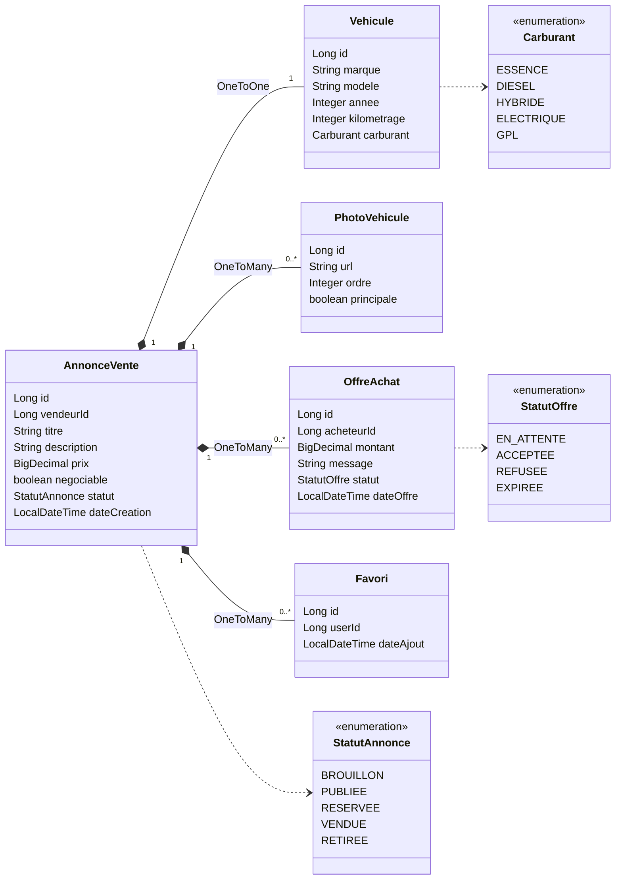

# vehicle-sales-service — MS1 Vente de véhicules

| Item            | Value                                                        |
|-----------------|--------------------------------------------------------------|
| Owner           | Jawher Benjeddou                                             |
| Port            | 8081 (second instance: 8091)                                 |
| Database        | MySQL `sales_db` on `localhost:3306`, created at startup if missing |
| Name in Eureka  | `VEHICLE-SALES-SERVICE`                                      |
| Stack           | Spring Boot 3.5.16, Spring Cloud 2025.0.0, Java 17, Spring Data JPA, Lombok |
| Package         | `tn.esprit.autoworld.vehiclesales`                           |

What this service contains for the workshop:

- 5 JPA entities with their associations
- one full CRUD, on sale listings (`AnnonceVente`), with the vehicle saved together with its listing
- an Eureka client registered on both Eureka servers
- Spring Boot Actuator: health, info, metrics, loggers

## Entities

| Entity          | Table            | Role |
|-----------------|------------------|------|
| `AnnonceVente`  | `annonce_vente`  | A sale listing created by a seller. Owns the CRUD. |
| `Vehicule`      | `vehicule`       | The vehicle sold by a listing. |
| `PhotoVehicule` | `photo_vehicule` | A photo of a listing. |
| `OffreAchat`    | `offre_achat`    | A purchase offer made by a buyer on a listing. |
| `Favori`        | `favori`         | A listing saved by a user. |



| Association | Mapping | Cascade |
|-------------|---------|---------|
| `AnnonceVente` → `Vehicule` | `@OneToOne`, foreign key `vehicule_id` in `annonce_vente` | `ALL` + `orphanRemoval` |
| `AnnonceVente` → `PhotoVehicule` | `@OneToMany(mappedBy = "annonce")`, `@ManyToOne` on the photo | `ALL` + `orphanRemoval` |
| `AnnonceVente` → `OffreAchat` | `@OneToMany(mappedBy = "annonce")`, `@ManyToOne` on the offer | `REMOVE` |
| `AnnonceVente` → `Favori` | `@OneToMany(mappedBy = "annonce")`, `@ManyToOne` on the favorite | `REMOVE` |

- A favorite is unique per `(userId, annonce)`.
- `vendeurId`, `acheteurId` and `userId` are ids of profiles owned by MS5. They are plain columns,
  without a foreign key, because each microservice has its own database.
- Deleting a listing deletes its vehicle, photos, offers and favorites.
- JSON recursion is avoided with `@JsonIgnore` on the `annonce` back-reference of photos, offers
  and favorites. There are no DTOs: the controller receives and returns the entity.

## Endpoints

Base URL: `http://localhost:8081`. Swagger UI, to try the endpoints from the browser:
http://localhost:8081/swagger-ui.html

| Method | Path | What it does | Status codes |
|--------|------|--------------|--------------|
| POST   | `/api/listings`       | Creates a listing and its vehicle | 201, 400 |
| GET    | `/api/listings`       | Lists all listings | 200 |
| GET    | `/api/listings/{id}`  | Returns one listing | 200, 404 |
| PUT    | `/api/listings/{id}`  | Updates a listing and its vehicle | 200, 400, 404 |
| DELETE | `/api/listings/{id}`  | Deletes a listing | 204, 404 |
| GET    | `/api/listings/hello` | Returns a message with the port of the instance that answered | 200 |

Request body of POST and PUT:

```json
{
  "vendeurId": 7,
  "titre": "Renault Clio 5 - tres bon etat",
  "description": "Premiere main",
  "prix": 48500,
  "negociable": true,
  "statut": "BROUILLON",
  "vehicule": {
    "marque": "Renault",
    "modele": "Clio 5",
    "annee": 2020,
    "kilometrage": 61000,
    "carburant": "ESSENCE"
  }
}
```

- Required: `vendeurId`, `titre`, `prix` (greater than 0) and every field of `vehicule`.
- `statut` is optional and defaults to `BROUILLON`.
- `id` and `dateCreation` are set by the server. `photos` appears in responses only.
- Invalid input returns 400 with one message per invalid field; an unknown id returns 404:

```json
{ "status": 404, "error": "Not Found", "message": "Listing 99 not found" }
```

## Run

Start MySQL (XAMPP) and the two Eureka servers first: see
[../eureka-server/README.md](../eureka-server/README.md).

```bash
cd Backend/vehicle-sales-service
mvnw.cmd spring-boot:run        # Windows
./mvnw spring-boot:run          # macOS / Linux
```

In IntelliJ, use the shared run configuration **VehicleSales8081** (stored in `.run/`).

At first startup the service creates the `sales_db` database and its tables. The tables start
empty: create a listing with POST.

## Run two instances

Start the first instance, then start a second one on port 8091. Both use the same database.

| Way | How |
|-----|-----|
| IntelliJ, shared config | Run **VehicleSales8091** (it sets the VM option `-Dserver.port=8091`) |
| IntelliJ, by hand | *Run → Edit Configurations*, copy the configuration, then *Modify options → Add VM options* → `-Dserver.port=8091` |
| Command line, Windows | `mvnw.cmd spring-boot:run -Dspring-boot.run.arguments=--server.port=8091` |
| Command line, macOS / Linux | `./mvnw spring-boot:run -Dspring-boot.run.arguments=--server.port=8091` |

Check which instance answers:

```bash
curl http://localhost:8081/api/listings/hello   # Hello from vehicle-sales-service on port 8081
curl http://localhost:8091/api/listings/hello   # Hello from vehicle-sales-service on port 8091
```

Both dashboards (http://localhost:8761/ and http://localhost:8762/) then show
`VEHICLE-SALES-SERVICE` with two instances: `vehicle-sales-service:8081` and
`vehicle-sales-service:8091`. Allow about 30 s for both dashboards to show them.

## curl examples

Written for macOS / Linux / Git Bash. On Windows cmd, import `postman_collection.json` into
Postman instead: it contains the same requests.

```bash
# Hello
curl http://localhost:8081/api/listings/hello

# Create -> 201
curl -X POST http://localhost:8081/api/listings \
  -H "Content-Type: application/json" \
  -d '{"vendeurId":7,"titre":"Renault Clio 5 - tres bon etat","description":"Premiere main","prix":48500,"negociable":true,"vehicule":{"marque":"Renault","modele":"Clio 5","annee":2020,"kilometrage":61000,"carburant":"ESSENCE"}}'

# List all -> 200
curl http://localhost:8081/api/listings

# Get one -> 200, or 404 if the id does not exist
curl http://localhost:8081/api/listings/1

# Update -> 200
curl -X PUT http://localhost:8081/api/listings/1 \
  -H "Content-Type: application/json" \
  -d '{"vendeurId":7,"titre":"Renault Clio 5 - prix revu","description":"Premiere main","prix":47000,"negociable":false,"statut":"PUBLIEE","vehicule":{"marque":"Renault","modele":"Clio 5","annee":2020,"kilometrage":61500,"carburant":"ESSENCE"}}'

# Delete -> 204
curl -X DELETE http://localhost:8081/api/listings/1
```

## Eureka client

```properties
eureka.client.service-url.defaultZone=http://localhost:8761/eureka,http://localhost:8762/eureka
eureka.client.register-with-eureka=true
eureka.client.fetch-registry=true
eureka.instance.prefer-ip-address=true
eureka.instance.instance-id=${spring.application.name}:${server.port}
```

The service registers with the first Eureka server that answers; the two servers copy the
registration to each other. `instance-id` contains the port, so two instances do not overwrite
each other in the registry.

## Actuator

| URL | Shows |
|-----|-------|
| http://localhost:8081/actuator/health | Status with details: database, Eureka, disk |
| http://localhost:8081/actuator/info | Name, version, description, owner |
| http://localhost:8081/actuator/metrics | Names of the available metrics |
| http://localhost:8081/actuator/metrics/http.server.requests | Count and total time of HTTP requests |
| http://localhost:8081/actuator/loggers | Log level of every logger |

The health status is sent to Eureka (`eureka.client.healthcheck.enabled=true`): when the
database is down, the instance is shown as `DOWN` on the dashboards instead of `UP`.

## Screenshots

Take these with both Eureka servers and both instances (8081 and 8091) running.

| # | What to capture | URL |
|---|-----------------|-----|
| 1 | Eureka server 1 with 2 instances of `VEHICLE-SALES-SERVICE` | http://localhost:8761/ |
| 2 | Eureka server 2 with 2 instances of `VEHICLE-SALES-SERVICE` | http://localhost:8762/ |
| 3 | Health, status `UP` with details | http://localhost:8081/actuator/health |
| 4 | Info | http://localhost:8081/actuator/info |
| 5 | Metrics list | http://localhost:8081/actuator/metrics |
| 6 | HTTP request metric | http://localhost:8081/actuator/metrics/http.server.requests |
| 7 | Loggers | http://localhost:8081/actuator/loggers |
| 8 | DB-down test, health `DOWN` | http://localhost:8081/actuator/health |
| 9 | DB-down test, instances `DOWN` in Eureka | http://localhost:8761/ |
| 10 | Swagger UI with the 6 endpoints | http://localhost:8081/swagger-ui.html |

DB-down test (screenshots 8 and 9):

1. With everything running, stop MySQL in the XAMPP control panel.
2. Open http://localhost:8081/actuator/health: `status` is `DOWN` and the `db` component is `DOWN`.
   The page can take up to 30 s to answer.
3. Wait about 1 min, then refresh http://localhost:8761/: the instances of
   `VEHICLE-SALES-SERVICE` are listed as `DOWN`.
4. Start MySQL again: health returns to `UP`, and so does Eureka after about 30 s.

## Project structure

```
src/main/java/tn/esprit/autoworld/vehiclesales/
  entity/       the 5 JPA entities and their enums
  repository/   Spring Data JPA repositories
  service/      AnnonceVenteService, impl/ holds its implementation
  controller/   AnnonceVenteController (CRUD + hello)
  exception/    ResourceNotFoundException and GlobalExceptionHandler (400 / 404)
src/main/resources/application.properties   database, Eureka and Actuator settings
postman_collection.json                     the CRUD and hello requests
.run/                                       IntelliJ run configurations for 8081 and 8091
```

A request goes controller → service → repository → database.

## Troubleshooting

| Symptom | Fix |
|---------|-----|
| `Communications link failure` at startup | MySQL is not running. Start it in XAMPP. |
| `Access denied for user 'root'` | Your MySQL root has a password. Set the `DB_PASSWORD` environment variable. |
| Warning `HHH000511: The 5.5.5 version for MySQLDialect is no longer supported` | Expected with XAMPP: it ships MariaDB, which reports itself this way. The service works. |
| `Port 8081 was already in use` | An instance is already running. Stop it or start this one on 8091. |
| Instance missing on one Eureka dashboard | Wait about 30 s for replication, then refresh. |
