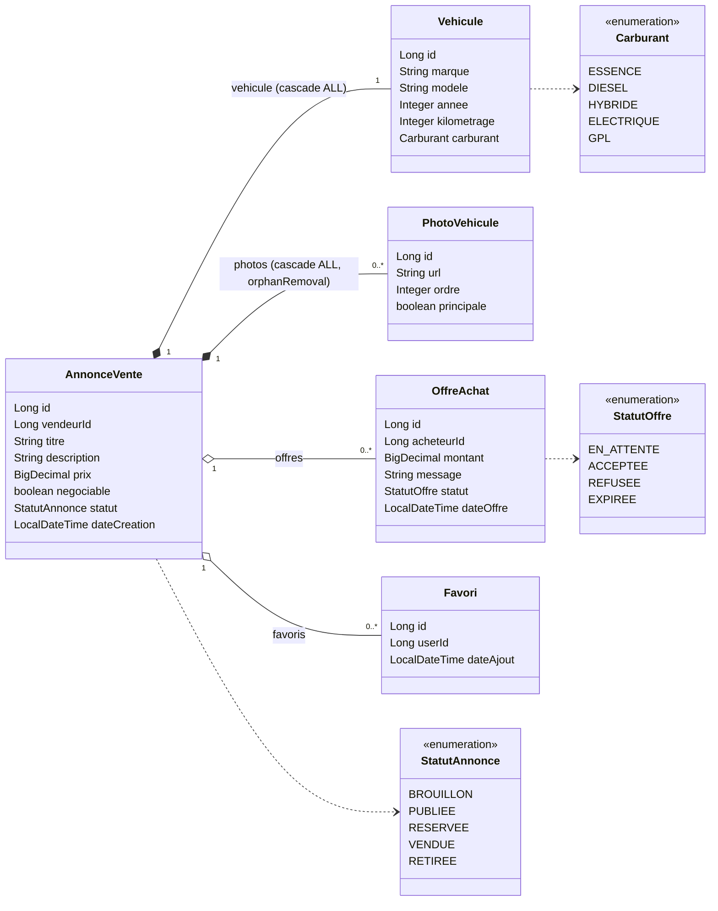
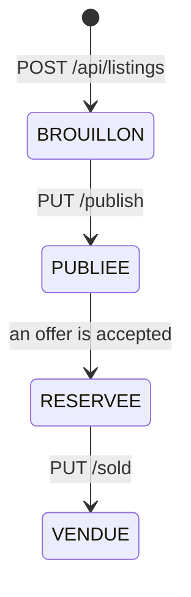

# vehicle-sales-service — MS1 Vente de véhicules

| Item            | Value                                                        |
|-----------------|--------------------------------------------------------------|
| Owner           | Jawher Benjeddou                                             |
| Port            | 8081 (second instance: 8091)                                 |
| Database        | MySQL `sales_db` on `localhost:3306`, created at startup if missing |
| Name in Eureka  | `VEHICLE-SALES-SERVICE`                                      |
| Stack           | Spring Boot 3.5.16, Spring Cloud 2025.0.0, Java 17, Spring Data JPA, Lombok |
| Package         | `tn.esprit.autoworld.vehiclesales`                           |

A seller creates a listing for a vehicle, publishes it, receives purchase offers, accepts one
(the listing becomes reserved) and marks it as sold. Users can add listings to their favorites
and compare up to three of them.

Not in this version, on purpose: OpenFeign, RabbitMQ, Keycloak and circuit breakers come in later
workshops. `vendeurId`, `acheteurId` and `userId` are plain ids of profiles owned by MS5; they
are not checked against MS5 yet.

## Data model



- A favorite is unique per `(userId, annonce)`.
- `vendeurId`, `acheteurId` and `userId` reference MS5 profiles without a foreign key.
- Offers and favorites are deleted together with their listing.
- Responses use DTOs, so there is no JSON recursion between a listing and its children.

Listing life cycle:



`RETIREE` exists in the enum but no endpoint sets it yet.

## Endpoints

Base URL: `http://localhost:8081`. Swagger UI: http://localhost:8081/swagger-ui.html

| Method | Path | What it does | Status codes |
|--------|------|--------------|--------------|
| GET    | `/api/listings/hello` | Message with the port of the instance that answered | 200 |
| POST   | `/api/listings` | Creates a listing and its vehicle in `BROUILLON` | 201, 400 |
| GET    | `/api/listings` | Lists listings. Optional filters: `marque`, `prixMin`, `prixMax`, `statut` | 200, 400 |
| GET    | `/api/listings/{id}` | One listing with its vehicle and photos | 200, 404 |
| PUT    | `/api/listings/{id}` | Updates the listing and its vehicle (not the status) | 200, 400, 404 |
| DELETE | `/api/listings/{id}` | Deletes the listing with its vehicle, photos, offers and favorites | 204, 404 |
| PUT    | `/api/listings/{id}/publish` | `BROUILLON` → `PUBLIEE` | 200, 404, 409 if not `BROUILLON` |
| POST   | `/api/listings/{id}/photos` | Adds a photo | 201, 400, 404 |
| POST   | `/api/listings/compare` | Returns up to 3 listings side by side | 200, 400, 404 |
| POST   | `/api/listings/{id}/offers` | Makes a purchase offer | 201, 400, 404, 409 if the listing is not `PUBLIEE` |
| PUT    | `/api/offers/{id}/decision` | Accepts or refuses a pending offer | 200, 400, 404, 409 |
| PUT    | `/api/listings/{id}/sold` | `RESERVEE` → `VENDUE` | 200, 404, 409 if not `RESERVEE` |
| POST   | `/api/listings/{id}/favorites` | Adds the listing to a user's favorites | 201, 400, 404, 409 if already a favorite |
| DELETE | `/api/listings/{id}/favorites?userId=` | Removes it from the user's favorites | 204, 400, 404 |

Rules worth knowing:

- **Decision on an offer.** The body is `{"decision":"ACCEPTEE"}` or `{"decision":"REFUSEE"}`.
  Accepting an offer sets the listing to `RESERVEE` and every other pending offer of that listing
  to `REFUSEE`. Deciding an offer that is no longer `EN_ATTENTE` returns 409.
- **Photos.** The first photo of a listing becomes its cover (`principale`). Sending
  `"principale": true` on a later photo moves the cover to it. `ordre` defaults to the next position.
- **Filters.** `marque` is an exact match, ignoring case. `prixMin` and `prixMax` are inclusive.
- **Compare.** The body is `{"ids":[1,2,3]}`: 1 to 3 distinct ids.

Errors always have the same JSON shape:

```json
{
  "timestamp": "2026-11-26T20:01:27",
  "status": 409,
  "error": "Conflict",
  "message": "Listing 4 cannot be published: status is PUBLIEE, expected BROUILLON",
  "path": "/api/listings/4/publish"
}
```

A validation error (400) adds a `fieldErrors` object with one message per invalid field.

## Run

Start MySQL (XAMPP) and the two Eureka peers first: see
[../eureka-server/README.md](../eureka-server/README.md).

```bash
cd Backend/vehicle-sales-service
mvnw.cmd spring-boot:run        # Windows
./mvnw spring-boot:run          # macOS / Linux
```

In IntelliJ, use the shared run configuration **VehicleSales8081** (stored in `.run/`).

At first startup the service creates `sales_db`, creates the tables and inserts 3 sample
listings (only when the listing table is empty).

Settings that can be overridden with environment variables: `PORT` (default 8081), `DB_USER`
(default `root`), `DB_PASSWORD` (default empty).

## Run two instances

Start the first instance and wait until it is up, then start the second one on port 8091.
Both instances share the same database.

| Way | How |
|-----|-----|
| IntelliJ, shared config | Run **VehicleSales8091** (it sets the VM option `-Dserver.port=8091`) |
| IntelliJ, by hand | Duplicate the run configuration, then *Modify options → Add VM options* → `-Dserver.port=8091` |
| Windows cmd | `set PORT=8091&& mvnw.cmd spring-boot:run` |
| Windows PowerShell | `$env:PORT=8091; .\mvnw.cmd spring-boot:run` |
| macOS / Linux | `PORT=8091 ./mvnw spring-boot:run` |

Check which instance answers:

```bash
curl http://localhost:8081/api/listings/hello   # Hello from vehicle-sales-service on port 8081
curl http://localhost:8091/api/listings/hello   # Hello from vehicle-sales-service on port 8091
```

Both dashboards (http://localhost:8761/ and http://localhost:8762/) then show
`VEHICLE-SALES-SERVICE` with `vehicle-sales-service:8081` and `vehicle-sales-service:8091`.
Allow about 30 s for the second dashboard to catch up.

## curl examples

The JSON bodies are written for macOS / Linux / Git Bash. On Windows cmd, import
`postman_collection.json` into Postman instead: it covers every endpoint.

```bash
# Create a listing (status BROUILLON) -> 201
curl -X POST http://localhost:8081/api/listings \
  -H "Content-Type: application/json" \
  -d '{"vendeurId":7,"titre":"Renault Clio 5 - tres bon etat","description":"Premiere main","prix":48500,"negociable":true,"vehicule":{"marque":"Renault","modele":"Clio 5","annee":2020,"kilometrage":61000,"carburant":"ESSENCE"}}'

# List, with and without filters
curl http://localhost:8081/api/listings
curl "http://localhost:8081/api/listings?marque=Peugeot&prixMin=50000&prixMax=60000&statut=PUBLIEE"

# Read, update, delete (replace 4 with the id returned by the creation)
curl http://localhost:8081/api/listings/4
curl -X PUT http://localhost:8081/api/listings/4 \
  -H "Content-Type: application/json" \
  -d '{"vendeurId":7,"titre":"Renault Clio 5 - prix revu","description":"Premiere main","prix":47000,"negociable":false,"vehicule":{"marque":"Renault","modele":"Clio 5","annee":2020,"kilometrage":61500,"carburant":"ESSENCE"}}'
curl -X DELETE http://localhost:8081/api/listings/4

# Publish, then add a photo
curl -X PUT http://localhost:8081/api/listings/4/publish
curl -X POST http://localhost:8081/api/listings/4/photos \
  -H "Content-Type: application/json" \
  -d '{"url":"https://placehold.co/800x600?text=Clio","principale":true}'

# Compare up to 3 listings
curl -X POST http://localhost:8081/api/listings/compare \
  -H "Content-Type: application/json" -d '{"ids":[1,2,3]}'

# Make an offer, accept it (listing -> RESERVEE), mark the listing as sold
curl -X POST http://localhost:8081/api/listings/4/offers \
  -H "Content-Type: application/json" \
  -d '{"acheteurId":21,"montant":45000,"message":"Disponible ce week-end ?"}'
curl -X PUT http://localhost:8081/api/offers/1/decision \
  -H "Content-Type: application/json" -d '{"decision":"ACCEPTEE"}'
curl -X PUT http://localhost:8081/api/listings/4/sold

# Favorites
curl -X POST http://localhost:8081/api/listings/1/favorites \
  -H "Content-Type: application/json" -d '{"userId":21}'
curl -X DELETE "http://localhost:8081/api/listings/1/favorites?userId=21"
```

## Actuator

| URL | Shows |
|-----|-------|
| http://localhost:8081/actuator/health | Status with details: database, Eureka, disk |
| http://localhost:8081/actuator/info | Name, version, description, owner |
| http://localhost:8081/actuator/metrics | Names of the available metrics |
| http://localhost:8081/actuator/metrics/http.server.requests | Count and total time of HTTP requests |
| http://localhost:8081/actuator/loggers | Log level of every logger |

The health status is sent to Eureka (`eureka.client.healthcheck.enabled=true`): when the
database is down, the instance is shown as `DOWN` on the dashboards instead of `UP`.

## Screenshots

Take these with both Eureka peers and both instances (8081 and 8091) running.

| # | What to capture | URL |
|---|-----------------|-----|
| 1 | Eureka peer 1 with 2 instances of `VEHICLE-SALES-SERVICE` | http://localhost:8761/ |
| 2 | Eureka peer 2 with 2 instances of `VEHICLE-SALES-SERVICE` | http://localhost:8762/ |
| 3 | Health, status `UP` with details | http://localhost:8081/actuator/health |
| 4 | Info | http://localhost:8081/actuator/info |
| 5 | Metrics list | http://localhost:8081/actuator/metrics |
| 6 | HTTP request metric | http://localhost:8081/actuator/metrics/http.server.requests |
| 7 | Loggers | http://localhost:8081/actuator/loggers |
| 8 | Swagger UI | http://localhost:8081/swagger-ui.html |
| 9 | Second instance answering | http://localhost:8091/api/listings/hello |
| 10 | DB-down test, health `DOWN` | http://localhost:8081/actuator/health |
| 11 | DB-down test, instances `DOWN` in Eureka | http://localhost:8761/ |

DB-down test (screenshots 10 and 11):

1. With everything running, stop MySQL in the XAMPP control panel.
2. Open http://localhost:8081/actuator/health: `status` is `DOWN` and the `db` component is `DOWN`
   (the page can take up to 30 s to answer while the connection pool times out).
3. Wait about 30 s to 1 min, then refresh http://localhost:8761/: the instances of
   `VEHICLE-SALES-SERVICE` are listed as `DOWN`.
4. Start MySQL again: health returns to `UP`, and so does Eureka after about 30 s.

## Project structure

```
src/main/java/tn/esprit/autoworld/vehiclesales/
  entity/       JPA entities and enums
  repository/   Spring Data repositories and the listing filter
  dto/          request and response records
  mapper/       entity <-> DTO conversions
  service/      interfaces, impl/ holds the business rules
  controller/   REST controllers
  exception/    exceptions and GlobalExceptionHandler (400 / 404 / 409)
  config/       DataSeeder (3 sample listings)
postman_collection.json   every endpoint, ready to import
.run/                     IntelliJ run configurations for 8081 and 8091
```

## Troubleshooting

| Symptom | Fix |
|---------|-----|
| `Communications link failure` at startup | MySQL is not running. Start it in XAMPP. |
| `Access denied for user 'root'` | Your MySQL root has a password. Set the `DB_PASSWORD` environment variable. |
| Warning `HHH000511: The 5.5.5 version for MySQLDialect is no longer supported` | Expected with XAMPP: it ships MariaDB, which reports itself this way. The service works. |
| `Port 8081 was already in use` | An instance is already running. Stop it or start this one on 8091. |
| Instance missing on one Eureka dashboard | Wait about 30 s for replication, then refresh. |
